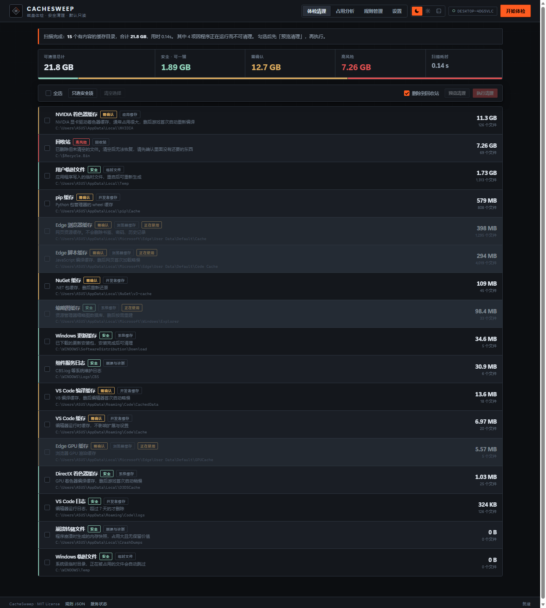
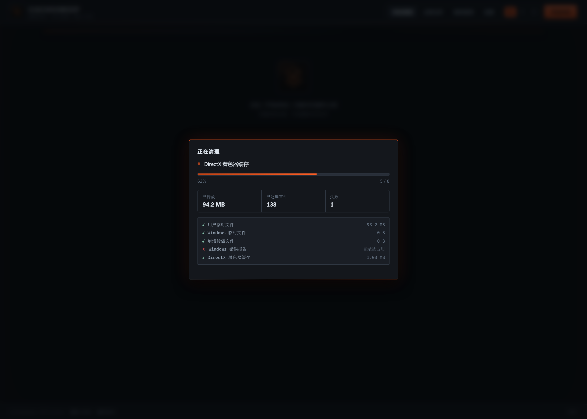
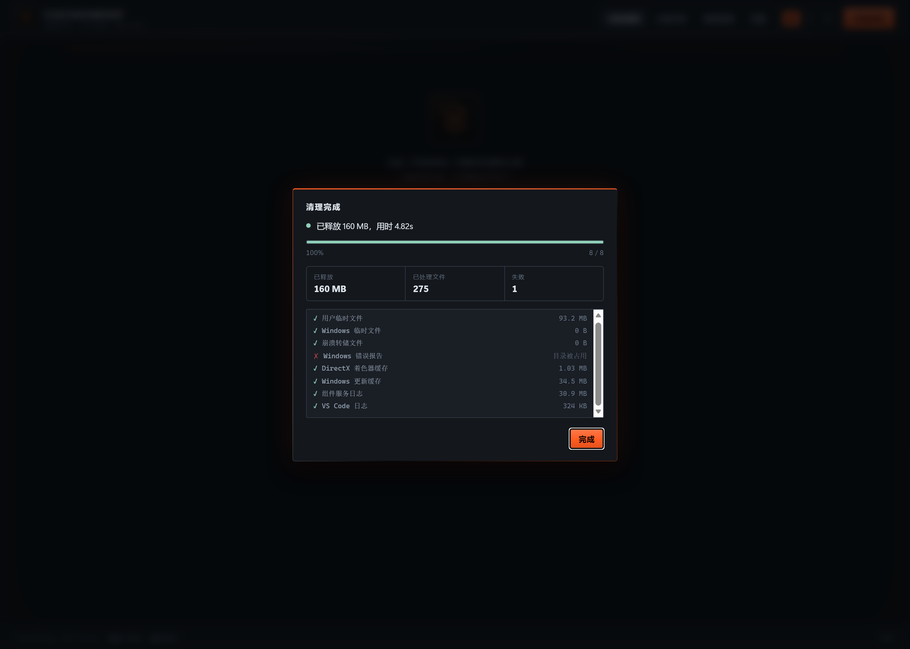
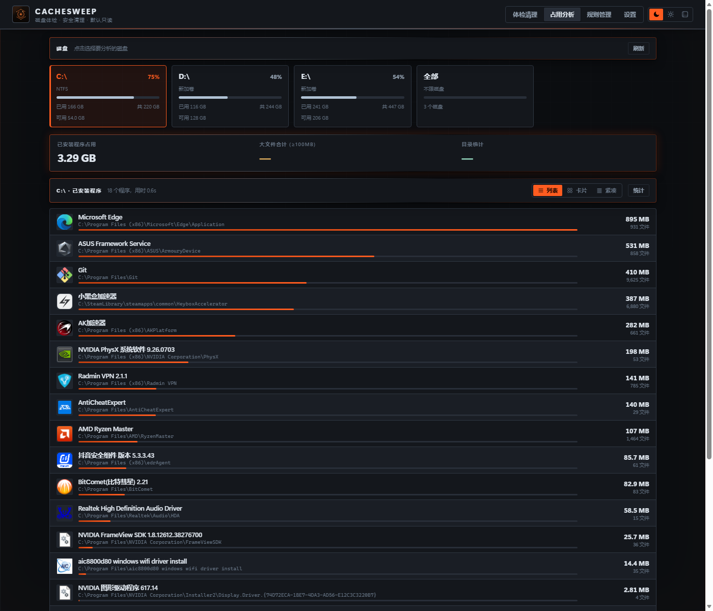
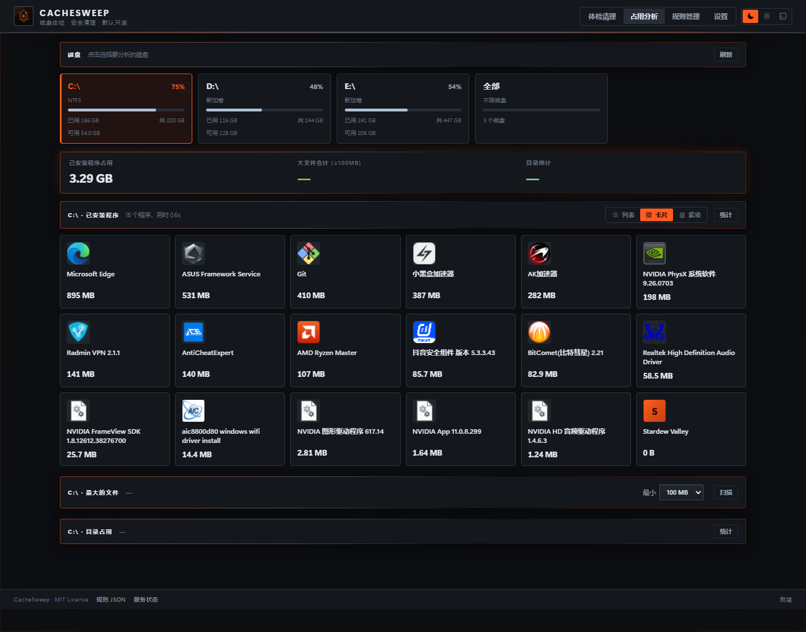
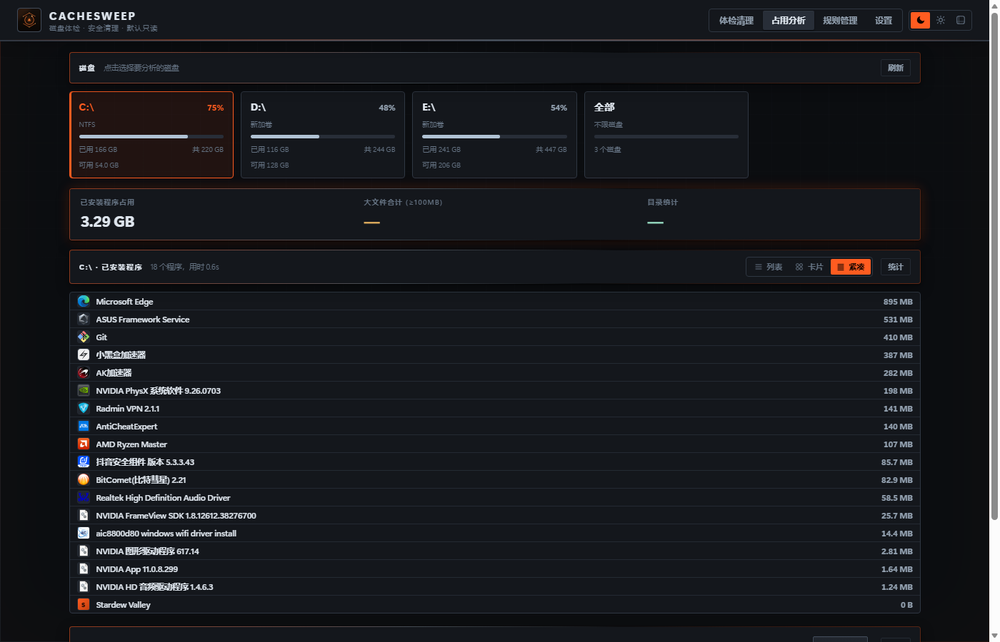
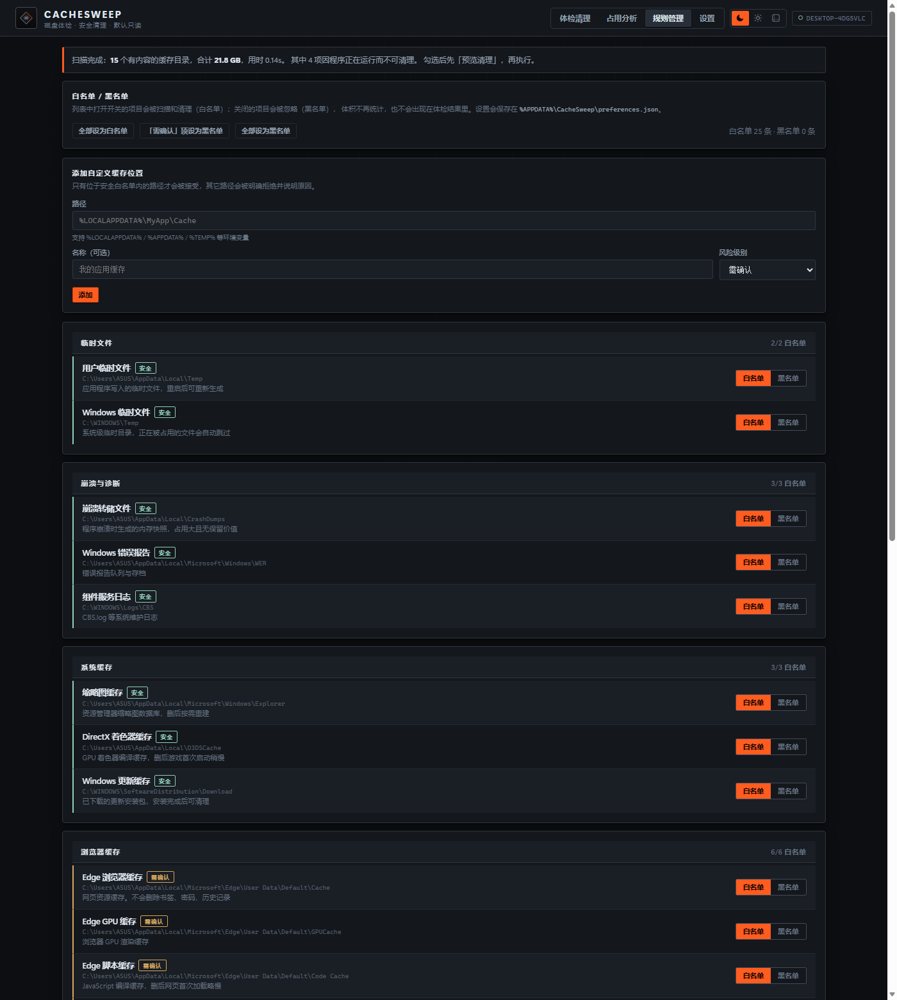
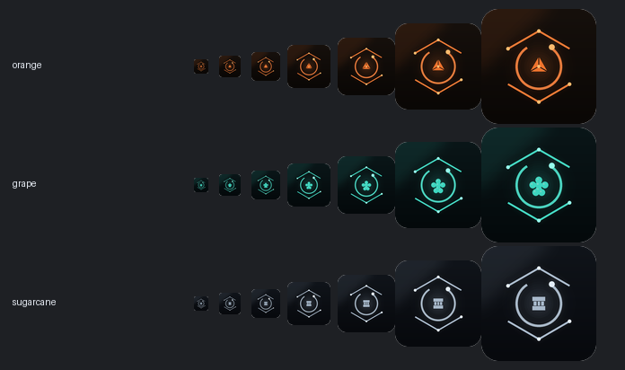

# CacheSweep

**磁盘体检与安全清理工具。** Windows 桌面程序（内嵌浏览器窗口 + 系统托盘），也可作为本地网页运行。

> 默认只读：扫描永不修改磁盘。清理必须你亲手勾选并确认。



## 为什么做它

Windows 自带的磁盘清理只认微软自己的路径，第三方缓存（npm、pip、pnpm、VS Code、NVIDIA）
和开发者工具的残留全都不管。CacheSweep 用**数据驱动的清理规则**覆盖这些路径，
并用一道硬白名单保证**永远碰不到**你的文档、桌面、凭证和系统目录。

在你机器上的实测：一次扫描找出 **21.8 GB** 可回收空间，耗时 **0.14 秒**。

## 三大功能

### 1. 体检清理

扫描 25 类缓存位置并列出真实体积，按风险分级展示：

| 级别 | 含义 | 行为 |
|---|---|---|
| **安全** | 删除后自动重建 | 可一键清理 |
| **需确认** | 会重新下载或首次启动变慢 | 需你勾选 |
| **高风险** | 可能含你还要找的数据 | 必须单独确认 |

流程是：扫描 → 勾选 → 预览 → 确认执行。预览只统计不删除，默认删除到回收站可恢复。

清理时会有**实时进度面板**：进度条按真实完成度推进、显示当前正在处理哪一项、
累计释放多少空间、处理了多少文件、失败几项，以及逐条操作日志。
清理几万个文件时不会让你干等着不知道发生了什么。

<p align="center">
  
  
</p>

### 2. 占用分析

直接回答"什么在占我硬盘"。**每个磁盘一张卡片**，点哪张就分析哪个盘：

<p align="center">
  
</p>

**已安装程序**从注册表读卸载信息，遍历安装目录算真实体积，并**提取每个程序自己的图标**。提供三种查看方式：

| 视图 | 适合 |
|---|---|
| **列表** | 名称 + 安装路径 + 体积比例条 + 文件数，信息最全 |
| **卡片** | 图标优先的网格，一屏认出熟悉的程序 |
| **紧凑** | 一行一个，密度最高，快速扫完整个盘 |

<p align="center">
  
  
</p>

另外还有**大文件**（按大小列出 ≥100MB 的文件）、**目录占用**（各顶层目录递归体积）。
切换磁盘时三块统计一起刷新。

实测这台机器：C 盘 18 个程序 3.29 GB，D 盘 5 个 1.91 GB，E 盘 9 个 67.38 GB。

### 3. 规则管理：白名单 / 黑名单

每条清理规则右侧可直接选择归属：

- **白名单**：允许被主动清理，参与扫描
- **黑名单**：不主动清理，扫描时跳过，不统计体积

新建与默认状态都是白名单。也可以添加自己的缓存目录——路径必须通过安全白名单，
否则会明确拒绝并说明原因。



## 三套主题

主题切换时，**窗口、任务栏、系统托盘、网页图标全部同步变色**：

| 主题 | 名称 | 配色 | 图标核心 |
|---|---|---|---|
| 深色 | **赤橙 · 暖橙主题** | 暖橙 `#FF7A30` | 柑橘瓣 |
| 浅色 | **青蔗 · 钢灰主题** | 钢灰 `#B0C2D4` | 甘蔗节段 |
| 透明 | **碧提 · 青提主题** | 青提 `#40E0C8` | 浆果簇 |

<p align="center">
  
</p>

三个图标共用同一科幻轮廓（开口六边形电路框 + 扫描环），只换配色和中心元素。

**透明主题**在桌面程序中是真正的亚克力玻璃窗口，能透出桌面壁纸，并带加重描边保证可读性。

## 下载与运行

从 [Releases](../../releases) 下载 `CacheSweep-win-x64.zip`，解压后双击 **`CacheSweep.exe`**。

托盘菜单：

| 菜单项 | 作用 |
|---|---|
| 打开 CacheSweep | 显示主窗口 |
| 立即体检 | 直接进入扫描流程 |
| 在浏览器中打开 | 用默认浏览器访问同一界面 |
| 打开日志目录 | `%LOCALAPPDATA%\CacheSweep\logs` |
| 重启服务 | 后台服务异常退出后手动重启 |
| 退出 | 停止服务并退出 |

> 需要 **WebView2 运行时**。Windows 11 及多数 Windows 10 已预装；
> 若缺失，程序会自动降级为在浏览器中打开界面并提示。

### 命令行版

```powershell
cachesweep.exe list                     # 查看所有规则
cachesweep.exe scan                     # 只读体检
cachesweep.exe clean safe               # 预览将释放的空间
cachesweep.exe clean safe --apply       # 真正删除（进回收站）
```

## 内置清理项

| 分类 | 内容 |
|---|---|
| 临时文件 | 用户 Temp、Windows Temp |
| 崩溃与诊断 | CrashDumps、Windows 错误报告、CBS 日志 |
| 系统缓存 | 缩略图缓存、DirectX 着色器缓存、Windows 更新缓存 |
| 浏览器缓存 | Edge / Chrome / Brave 的 Cache、GPUCache、Code Cache |
| 应用缓存 | NVIDIA 着色器缓存 |
| 开发者缓存 | npm、pip、pnpm、Yarn、NuGet、VS Code |
| 回收站 | 清空回收站（高风险，需单独确认） |

## 安全模型

三道独立防线，每一道都有测试覆盖：

1. **允许根白名单**：只有明确列出的缓存目录可能被碰，未知路径默认拒绝
2. **永不触碰黑名单**：文档、桌面、下载、浏览器密码、系统目录一律拦截
3. **逐条路径复查**：删除每个文件前再验一次，规则被篡改也删不到白名单外

另外：默认 dry-run、默认进回收站、进程守卫（浏览器开着就不动它的缓存）、
危险项需显式授权、CSRF 防护、审计日志。

详见 [docs/SAFETY.md](docs/SAFETY.md)。

CacheSweep **不会**删除：

- 文档、图片、桌面、下载、音乐、视频
- 浏览器密码、书签、Cookie、历史记录
- 系统文件、已安装软件本体
- Office / 微信 / QQ 的聊天记录与配置

程序以普通用户权限运行（`asInvoker`），不请求管理员提权。
所有操作写入 `%LOCALAPPDATA%\CacheSweep\logs\`。

**占用分析**只读：列出程序、文件、目录体积，不提供删除按钮。

## 从源码构建

需要 [.NET 8 SDK](https://dotnet.microsoft.com/download/dotnet/8.0)。

```powershell
git clone https://github.com/TA-yuma/CacheSweep.git
cd CacheSweep

dotnet test                     # 36 个测试必须全绿
.\scripts\run.ps1               # 开发模式（仅服务，浏览器访问）
.\scripts\publish.ps1           # 打包完整桌面版
.\scripts\install-shortcut.ps1  # 在桌面创建快捷方式
```

产物布局：

```
artifacts\package\
  CacheSweep.exe          桌面外壳（托盘 + 内嵌窗口）
  CacheSweep.Server.exe   后台服务（由外壳拉起，无窗口）
  wwwroot\                网页界面
  Assets\                 图标（含三套主题图标）
artifacts\dist\
  CacheSweep-win-x64.zip
  CacheSweep-cli-win-x64.zip
```

其他脚本：

| 脚本 | 用途 |
|---|---|
| `scripts/make_icons_fusion.py` | 重新生成三套主题图标（需要 Pillow） |
| `scripts/screenshot.mjs` | 用 CDP 截取各主题/视图的文档截图（需要 Node） |

## 自定义规则

在「规则管理」页添加，或直接编辑 `%APPDATA%\CacheSweep\rules.json`：

```json
{
  "targets": [{
    "id": "my-app-cache",
    "name": "我的应用缓存",
    "description": "说明它是什么、删除会有什么影响",
    "path": "%LOCALAPPDATA%\\MyApp\\Cache",
    "category": "AppCache",
    "risk": "Caution"
  }]
}
```

路径**必须**落在允许白名单内。详见 [docs/ARCHITECTURE.md](docs/ARCHITECTURE.md)，
以及给贡献者的 [docs/ADDING_RULES.md](docs/ADDING_RULES.md)。

## 项目结构

```
CacheSweep
├── src\
│   ├── CacheSweep.Core\        扫描、规则、清理、占用统计引擎
│   │   ├── Models\             数据模型
│   │   ├── Safety\             ★ 路径白名单（安全命门）
│   │   ├── Rules\              清理规则 + 用户偏好
│   │   ├── Scanning\           目录体积、已安装程序、大文件统计
│   │   └── Cleaning\           删除执行器
│   ├── CacheSweep.Desktop\     托盘外壳 + WebView2 内嵌窗口 + 主题图标
│   ├── CacheSweep.Server\      Minimal API + 网页前端
│   └── CacheSweep.Cli\         命令行版
├── tests\                      单元测试
├── docs\                       安全模型、架构、添加规则、截图
├── scripts\                    run / publish / install-shortcut / 图标生成
└── .github\workflows\          CI：测试 + 发布
```

## 平台支持

| 平台 | 状态 |
|---|---|
| Windows 10 / 11 x64 | ✅ 完整支持 |
| Windows ARM64 | ⚠️ 可自行 `-r win-arm64` 发布，未测试 |
| Linux / macOS | ❌ 桌面外壳与回收站 API 仅 Windows |

## 贡献

见 [CONTRIBUTING.md](CONTRIBUTING.md)。加一条清理规则通常只需要改 JSON 文件。

投稿、建议与反馈请发送至：**1178111090@qq.com**

## License

[MIT](LICENSE)
